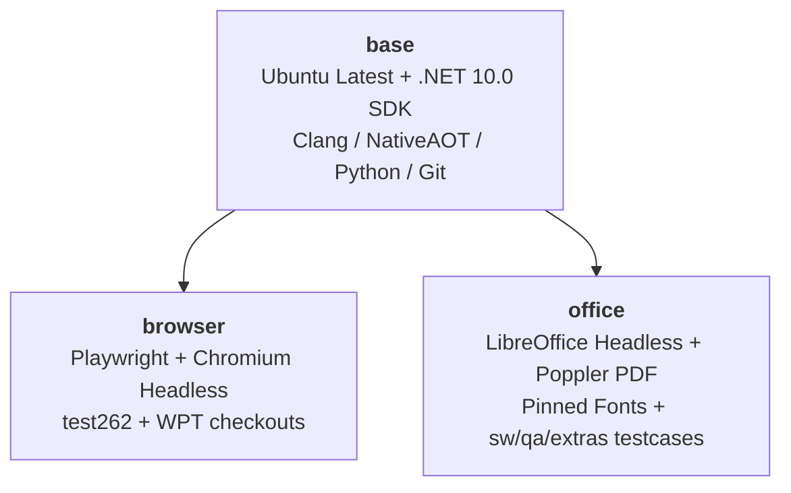

# Broiler.SDK Container Images for GitHub Container Registry (GHCR)

Pre-built, deterministic CI container images based on `ubuntu-latest` for the [Broiler Platform](https://github.com/Broiler-Platform), published to the **GitHub Container Registry (`ghcr.io`)** as part of `Broiler.SDK`.

These containers eliminate long provisioning and package-installation delays in GitHub Actions CI workflows by pre-installing the .NET 10.0 SDK, browser verification engines, office tools, and test suites.

---

## Container Hierarchy & Overview



| Container | Image Name (GHCR) | Description | Key Environment Variables |
| :--- | :--- | :--- | :--- |
| **`base`** | `ghcr.io/broiler-platform/broiler-sdk-base:latest`<br>`ghcr.io/broiler-platform/base:latest` | Base Ubuntu image with the latest .NET 10.0 SDK, C/C++ NativeAOT compiler tools (`clang`, `zlib1g-dev`), Python 3, Git, and build utilities. | `DOTNET_ROOT=/usr/share/dotnet`<br>`PATH="/usr/share/dotnet:..."` |
| **`browser`** | `ghcr.io/broiler-platform/broiler-sdk-browser:latest`<br>`ghcr.io/broiler-platform/browser:latest` | Extends `base` with Node.js LTS, Playwright, Chromium headless, and local shallow clones of `tc39/test262` and `web-platform-tests/wpt`. | `PLAYWRIGHT_BROWSERS_PATH=/ms-playwright`<br>`TEST262_ROOT=/opt/test262`<br>`WPT_ROOT=/opt/wpt` |
| **`office`** | `ghcr.io/broiler-platform/broiler-sdk-office:latest`<br>`ghcr.io/broiler-platform/office:latest` | Extends `base` with LibreOffice headless, `poppler-utils` (`pdftoppm`), pinned metric-compatible fonts, and LibreOffice `sw/qa/extras` testcases. | `BROILER_SOFFICE=/usr/bin/soffice`<br>`BROILER_PDFTOPPM=/usr/bin/pdftoppm`<br>`BROILER_OFFICE_FONT_DIR=/usr/share/fonts/truetype`<br>`BROILER_OFFICE_EXTRAS_DIR=/opt/libreoffice-extras` |

---

## Container Details

### 1. `base`
- **Base OS**: `ubuntu:24.04` (Ubuntu 24.04 LTS Noble Numbat, matching GitHub Actions `ubuntu-latest` runner LTS).
- **.NET 10.0 SDK**: Latest .NET 10.0 SDK installed into `/usr/share/dotnet`, linked to `/usr/bin/dotnet`.
- **NativeAOT & C/C++ Toolchain**: `build-essential`, `clang`, `zlib1g-dev`, `libicu-dev`, `libssl-dev`, `pkg-config` (required for publishing Linux NativeAOT heads in `Broiler.Writer` and `Broiler.Code`).
- **Development & CI Utilities**: `git`, `curl`, `wget`, `jq`, `ca-certificates`, `tar`, `gzip`, `unzip`, `python3`, `python3-pip`, `python3-venv`.

### 2. `browser`
- **Inherits from**: `base`
- **Node.js**: Modern Node.js LTS (v22.x) and npm from official NodeSource distributions.
- **Playwright & Chromium**: `playwright@1.59.1` installed globally, with Chromium headless and all system dependencies (`libasound2t64`, `libnss3`, `libgbm1`, `libxkbcommon0`, etc.) pre-installed into `/ms-playwright`.
- **test262 Checkout**: Cloned into `/opt/test262`, pinned to the verified ECMAScript test suite commit (`ccaac100ff49d81e9ff47a75ff4c60e0bd3f262e`).
- **WPT Checkout**: Cloned into `/opt/wpt` from `https://github.com/web-platform-tests/wpt.git`.
- **Headless Display**: `xvfb` and `xauth` pre-installed for headless graphics rendering or virtual display testing.

### 3. `office`
- **Inherits from**: `base`
- **LibreOffice Headless**: `libreoffice-writer`, `libreoffice-calc`, and `libreoffice-core` pre-installed (`soffice --version` verified).
- **PDF Tools**: `poppler-utils` (`pdftoppm`, `pdffonts`, `pdfinfo`, `pdftotext`), `qpdf`, and `ghostscript`.
- **Pinned Fonts**: Metric-compatible fonts for deterministic rendering comparison:
  - Liberation Fonts (`fonts-liberation2`): Arial, Times New Roman, Courier New metric compatibility.
  - Carlito (`fonts-crosextra-carlito`): Calibri metric compatibility.
  - Caladea (`fonts-crosextra-caladea`): Cambria metric compatibility.
  - DejaVu (`fonts-dejavu-core`): DejaVu Sans, Serif, and Mono.
  - Font cache updated with `fc-cache -fv`.
- **LibreOffice Testcases**: Pinned `sw/qa/extras` corpus from LibreOffice core repository (`https://github.com/LibreOffice/core.git`) sparse-checked out into `/opt/libreoffice-extras`.

---

## Using in GitHub Actions

In any Broiler workflow (such as `Broiler.Browser`, `Broiler.Writer`, or `Broiler.Documents`), reference the GHCR container directly in the job definition:

### Example: Running WPT / Browser Tests in `Broiler.Browser`
```yaml
jobs:
  browser-tests:
    runs-on: ubuntu-latest
    container:
      image: ghcr.io/broiler-platform/broiler-sdk-browser:latest
    steps:
      - name: Check out repository
        uses: actions/checkout@v5

      # .NET 10, Chromium, test262 and WPT are already pre-installed!
      - name: Run browser test suite
        run: |
          echo "WPT available at: $WPT_ROOT"
          echo "test262 available at: $TEST262_ROOT"
          dotnet test Broiler.Browser.Tests.slnx -c Release
```

### Example: Running Office Conformance in `Broiler.Writer` or `Broiler.Documents`
```yaml
jobs:
  office-conformance:
    runs-on: ubuntu-latest
    container:
      image: ghcr.io/broiler-platform/broiler-sdk-office:latest
    steps:
      - name: Check out repository
        uses: actions/checkout@v5

      # LibreOffice, pdftoppm, pinned fonts, and sw/qa/extras are pre-installed!
      - name: Run office conformance
        run: |
          ./eng/run-office-conformance.sh \
            --skip-install \
            --extras-dir "$BROILER_OFFICE_EXTRAS_DIR" \
            --font-dir "$BROILER_OFFICE_FONT_DIR"
```

---

## Local Development & Building

### Using Helper Scripts

**Bash (Linux / macOS / WSL / Git Bash):**
```bash
# Build all three containers
./docker/build.sh all

# Build with smoke verification tests
./docker/build.sh all --test

# Build a single container
./docker/build.sh base
./docker/build.sh browser
./docker/build.sh office

# Push to a custom registry or tag
./docker/build.sh all --registry ghcr.io --owner my-org --tag dev --push
```

**PowerShell (Windows):**
```powershell
# Build all containers with verification
.\docker\build.ps1 -Target all -Test

# Build and push to registry
.\docker\build.ps1 -Target all -Push
```

### Using Docker Compose
```bash
cd docker

# Build all images
docker compose build

# Build a specific service
docker compose build base
docker compose build browser
docker compose build office
```

---

## Performance Telemetry & Optimization

Every container is equipped with an automatic startup banner and diagnostic command (`broiler-info` or `broiler-perf`) that inspects cgroup quotas, memory allocations, `/dev/shm`, storage mount speeds, and runtime settings.

```text
================================================================================
  BROILER PLATFORM CI CONTAINER — PERFORMANCE & RESOURCE DIAGNOSTICS
================================================================================
• Environment: Ubuntu 24.04.1 LTS (x86_64) | Kernel: 6.6.137 | Role: browser
• Cgroup Mode: v2 (unified)
• CPU Resources:
    Host Physical/Logical: 16 cores (AMD Ryzen 9 / Intel Core i9)
    Cgroup Allocation:     Unlimited (all 16 host cores)
    CFS Throttling:        None (0 periods throttled)
• Memory Resources:
    Host Total RAM:        31.25 GiB (33,554,432 bytes)
    Cgroup Limit:          Unlimited (Host RAM: 31.25 GiB)
    Current Consumption:   214.30 MiB
• Shared Memory (/dev/shm): 2.0 GiB (2048 MiB)
• Storage & Mounts:
    Root Filesystem (/):   overlay
    Temp Directory (/tmp): tmpfs
    Workspace Mount:       container-local (overlay2)
• .NET 10 Environment:
    SDK Version:           10.0.403 (Root: /usr/share/dotnet)
    Tiered PGO:            1 | QuickJitForLoops: 1
    File Watcher:          Polling=false
    NuGet XML Docs:        skip
• Browser & Conformance Tools:
    Node.js:               v22.14.0
    Playwright:            Version 1.59.1 (Path: /ms-playwright)
    Platform Override:     ubuntu24.04-x64
    test262 Directory:     /opt/test262 [OK]
    WPT Directory:         /opt/wpt [OK]
• Performance Analysis & Alerts:
  [OK] No critical resource bottlenecks detected. Container is operating at native speed.
================================================================================
```

### Why Containers Run Slower than the Host & How to Fix It

If the container runs significantly slower than the host machine, check the following common bottlenecks:

#### 1. Shared Memory (`/dev/shm`) Throttling (Chromium & Playwright)
* **The Problem:** By default, Docker allocates only **64MB** to `/dev/shm`. Chromium renders frames and allocates shared IPC memory in `/dev/shm`. When 64MB is exhausted, Chromium falls back to disk thrashing on `/tmp`, causing **10x–50x performance drops** or `SIGBUS` crashes.
* **The Fix:**
  - In `docker run`: add `--shm-size=2gb` or `--ipc=host`.
  - In `docker-compose.yml`: `shm_size: '2gb'` is configured by default.

#### 2. Host Bind Mount I/O (Windows / macOS / WSL2)
* **The Problem:** Mounting a Windows directory into the container (`-v D:\project:/workspace`) routes all file system I/O through the 9P / virtiofs driver. For `.NET` compilation and `npm`/Playwright, creating thousands of small files (`obj/`, `bin/`, `node_modules/`) across the VM boundary is up to **20x slower** than native Linux ext4.
* **The Fix:**
  - Keep build output (`obj/`, `bin/`) and package caches inside native container storage or Docker named volumes.
  - Mount `/tmp` as a `tmpfs` in RAM: `--tmpfs /tmp:exec,mode=1777` (configured in `docker-compose.yml`).
  - Set `DOTNET_USE_POLLING_FILE_WATCHER=false` (pre-configured in base image) to avoid 100% CPU spinning on mounted volumes.
  - Set `NUGET_XMLDOC_MODE=skip` (pre-configured in base image) to cut restore I/O by 40%.

#### 3. Docker Desktop / WSL2 Resource Starvation
* **The Problem:** On Windows, Docker Desktop / WSL2 may default to only 2 or 4 CPU cores and 4GB RAM, even if your physical machine has 16+ cores and 32GB+ RAM. If the container is allocated only 2 cores, parallel MSBuild and Playwright tests will be CPU-throttled.
* **The Fix:**
  - Open `~/.wslconfig` (or Docker Desktop Settings → Resources) and allocate sufficient CPUs and memory:
    ```ini
    [wsl2]
    processors=8
    memory=16GB
    swap=4GB
    ```
  - Verify container allocation using `broiler-info`.

#### 4. .NET 10 Runtime Optimization Flags (Pre-configured)
The following environment variables are pre-configured in `base/Dockerfile`:
* `DOTNET_TieredPGO=1`: Enables Dynamic Profile-Guided Optimization for higher steady-state execution speed.
* `DOTNET_TC_QuickJitForLoops=1`: Enables Tier 0 Quick JIT for methods containing loops, speeding up test startup.
* `DOTNET_GENERATE_ASPNET_CERTIFICATE=0`: Skips HTTPS dev certificate generation on startup.
* `NUGET_XMLDOC_MODE=skip`: Skips extracting XML doc files during package restore.

---

## CI Publishing Workflow

The GitHub Actions workflow [`.github/workflows/docker-publish.yml`](../.github/workflows/docker-publish.yml) automates building and publishing the images:
- **Triggers**:
  - Automatically runs when files in `docker/**` are pushed to `main`.
  - Runs validation builds on pull requests touching `docker/**` (without pushing).
  - Can be manually dispatched via `workflow_dispatch` with custom tags and push controls.
- **Authentication**: Uses `GITHUB_TOKEN` with `packages: write` permissions to authenticate against `ghcr.io`.
- **Caching**: Employs GitHub Actions cache backend (`type=gha`) for fast incremental builds.
